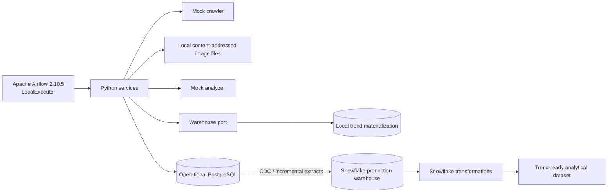

# Architecture

## Runtime shape

The prototype separates domain work from infrastructure through small ports in `crawltech.adapters`, `crawltech.repositories`, and `crawltech.warehouses`. `IngestionService` coordinates crawler, image-storage, analyzer, and repository calls; the Airflow DAG only supplies bounded inputs and invokes these services.

The local implementation runs without external credentials. The mock crawler emits fictional authors and posts; local storage creates deterministic PNG files; the mock analyzer emits versioned attributes and normalized bounding boxes. No social network or computer-vision API is called.

## Storage boundaries

The application PostgreSQL database owns operational state: networks, authors, posts, image references, analysis results, segment assignments and their history, crawl runs/batches, and quality results. The actual image bytes live on the mounted local filesystem and are referenced by content hash and path. Airflow has a different PostgreSQL database for its own metadata, task state, and connections; neither database substitutes for Snowflake.

In production, the operational store remains the system of record for ingestion. Incremental change capture or scheduled extracts publish stable operational keys and versioned facts into Snowflake. The warehouse port is deliberately independent of the SQLAlchemy repository, so a Snowflake implementation can replace the local materializer without changing business services.

See [Data Model](data-model.md), [Orchestration and Scaling](orchestration-and-scaling.md), and the explicitly labeled [Snowflake transformation](../sql/transformations/trend_dataset.sql).